# Amouratte 𐙚

**A coquette-inspired e-commerce site for customizable gift boxes, made for the NSBM community.**

Amouratte makes gift-giving more personal. Customers can pick from pre-designed gift sets or build their own box from individual items, all wrapped in a soft pink, coquette-style design. Administrators manage products and orders from a dedicated admin panel.


🎥 **[Watch the video demo](https://drive.google.com/file/d/1QBnUzz0PrwFP7PUGQk8sYYcBZrL6qSoO/view?usp=sharing)**

<p align="center">
  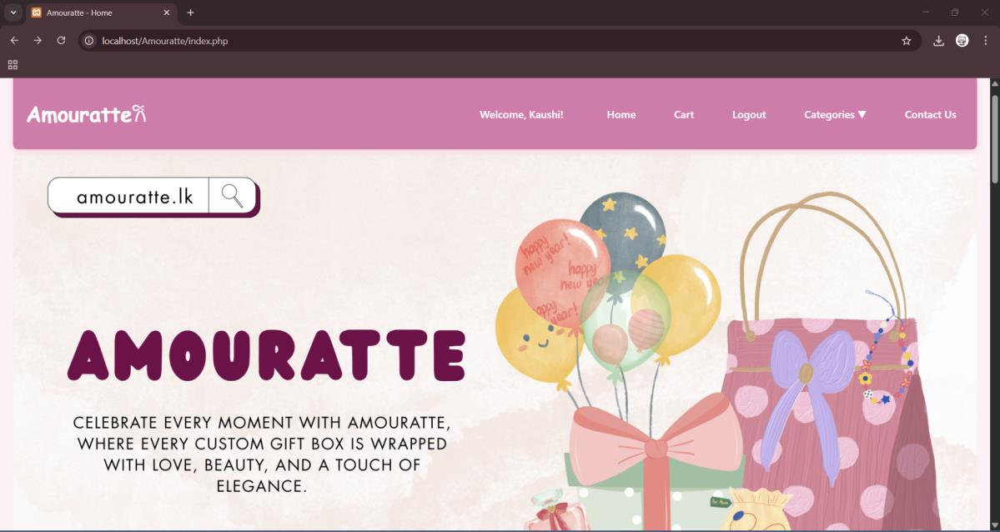
</p>

---

## ✨ Features

### 🛍️ Customer side
- **Homepage** with hero banner, promotional offers and featured products
- **Category browsing and filtering**
- **Product pages** with images, descriptions and prices
- **Shopping cart**: adjust quantities, see the running total, clear the cart
- **Checkout** with an order review and a thank-you confirmation (simulated purchase)
- **Customer accounts**: register and log in
- **Contact page** with an enquiry form, email/phone details and social links

### 🔧 Admin panel
- **Admin login** to protect product and order data
- **Dashboard** with full **CRUD** for products: add, view, edit and delete
- **Order management** connected to customer checkouts

### 🎀 Design
- Coquette-style pink gradient palette for a recognisable brand identity
- Fully responsive layout for desktop, tablet and mobile (Bootstrap)
- Custom brand logo and theme

---

## 📸 Screenshots

### Shopping

<table>
  <tr>
    <td align="center">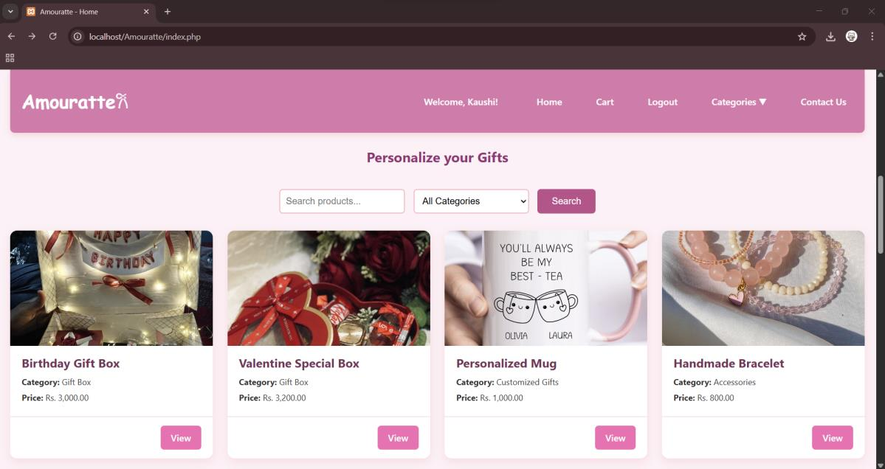<br><b>Gift catalogue</b> with search and categories</td>
    <td align="center">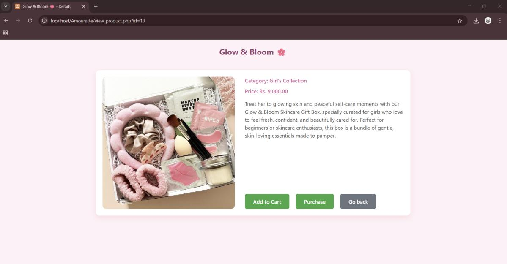<br><b>Product details</b></td>
  </tr>
  <tr>
    <td align="center">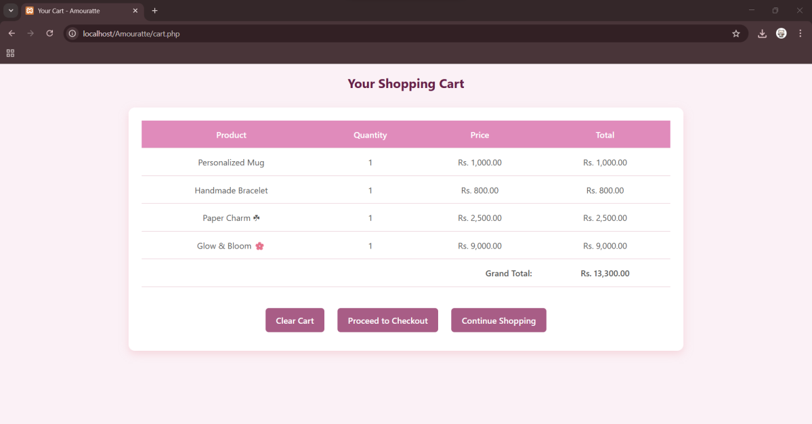<br><b>Shopping cart</b></td>
    <td align="center">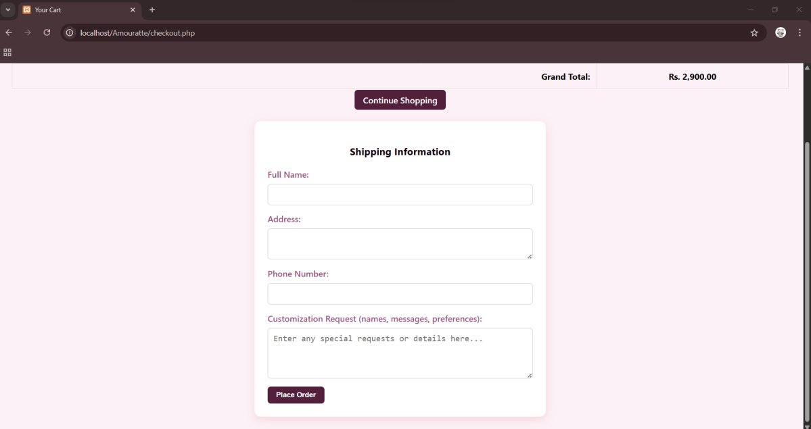<br><b>Checkout</b></td>
  </tr>
  <tr>
    <td align="center">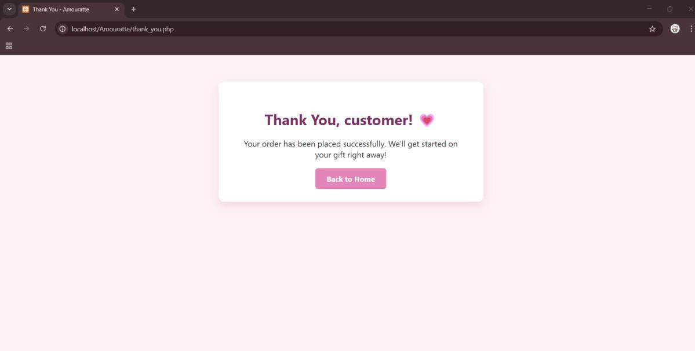<br><b>Order confirmation</b></td>
    <td align="center">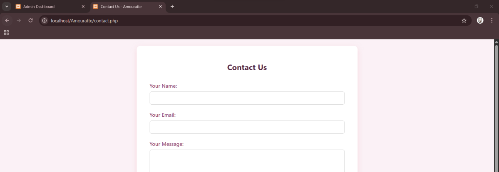<br><b>Contact page</b></td>
  </tr>
  <tr>
    <td align="center">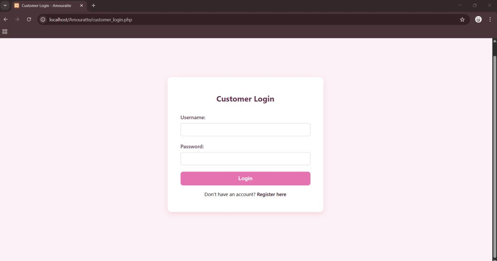<br><b>Customer login</b></td>
    <td align="center">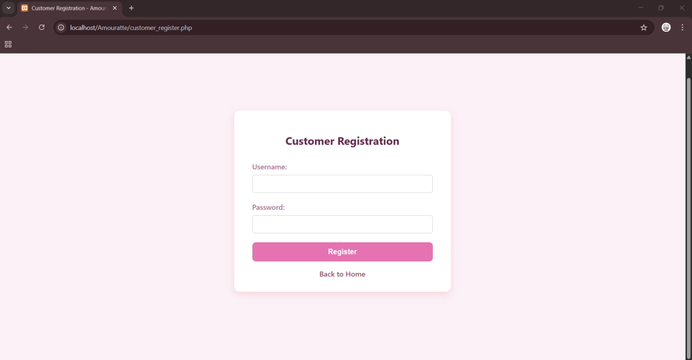<br><b>Customer registration</b></td>
  </tr>
</table>

### Admin panel

<table>
  <tr>
    <td align="center">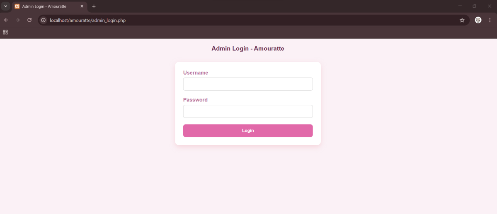<br><b>Admin login</b></td>
    <td align="center">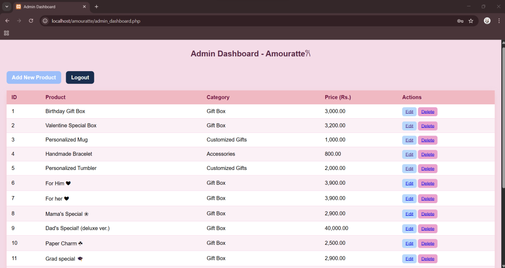<br><b>Product management dashboard</b></td>
  </tr>
  <tr>
    <td align="center">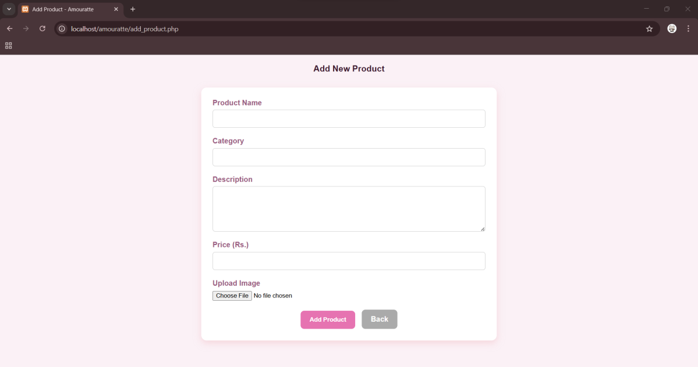<br><b>Add product</b></td>
    <td align="center">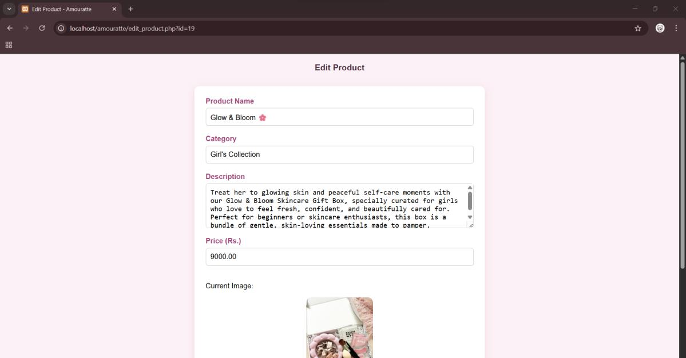<br><b>Edit product</b></td>
  </tr>
</table>

---

## 📂 Project structure

```
├── index.php                      Homepage
├── view_product.php               Product details
├── add_to_cart.php                Add item to cart
├── cart.php / clear_cart.php      Cart
├── checkout.php                   Order review
├── checkout_process.php           Places the order
├── purchase.php / thank_you.php   Confirmation
├── customer_register(.php|_process.php)
├── customer_login(.php|_process.php)
├── contact(.php|_process.php)     Contact form
├── admin_login.php                Admin sign-in
├── admin_dashboard.php            Product & order management
├── add_product.php / edit_product.php / delete_product.php
├── logout.php
├── db.php                         MySQL connection settings
├── amouratte_db.sql               Database schema + sample data
└── screenshots/                   README images
```

### Database (`amouratte_db`)

| Table | Holds |
|---|---|
| `products` | Gift boxes and items, prices, categories, images |
| `customers` | Customer accounts |
| `orders` | Placed orders |
| `admins` | Admin accounts |
| `messages` | Contact form submissions |

---

## 🚀 Running it locally

### Requirements
- [XAMPP](https://www.apachefriends.org/) (or any Apache + PHP + MySQL stack)
- phpMyAdmin (bundled with XAMPP)

### Steps
1. **Clone the repo into your web root**
   ```bash
   cd C:/xampp/htdocs
   git clone https://github.com/MenadiDev/Amouratte.git
   ```
2. **Start Apache and MySQL** from the XAMPP Control Panel.
3. **Create the database**
   - Open <http://localhost/phpmyadmin>
   - Create a database called `amouratte_db`
   - Import `amouratte_db.sql`
4. **Check the connection settings** in `db.php` (default: `localhost`, user `root`, no password).
5. **Open the site**
   - Store: <http://localhost/Amouratte/>
   - Admin panel: <http://localhost/Amouratte/admin_login.php>

> The SQL file includes demo admin accounts for testing. Change those credentials before putting the site anywhere public.

---

## 🛠️ Tech stack

| Layer | Technology | Purpose |
|---|---|---|
| Frontend | HTML, CSS, Bootstrap | Responsive, branded UI |
| Backend | PHP | Server-side logic, forms, sessions, database access |
| Database | MySQL | Products, customers, orders |
| DB tool | phpMyAdmin | Database management |

---

## 🛣️ Possible improvements

- Password hashing (`password_hash`) and prepared statements throughout
- Real payment gateway integration
- "Build your own box" visual builder
- Order history for customers
- Product reviews and wishlists

---

## 👥 Team (Group D)

| Member | Role | Contributions |
|---|---|---|
| **Menadi P. D** | Team Leader & Full-Stack Developer | Admin dashboard with CRUD, order management, homepage, product details and checkout pages, frontend–MySQL integration, cart-to-order logic |
| Fernando C. G. K | Backend & Database Developer | Database schema, secure login, product categorisation and search, backend performance |
| Hiranya R. A. D. D | UI Designer & Frontend Developer | Product pages, responsive layouts, cart/login/register pages, brand logo and theme |
| Sandeepani K. K | Tester & UI Designer | UI design, testing, responsiveness checks, screenshots, social media |

---

<sub>Built as a web development group project at NSBM Green University.</sub>
